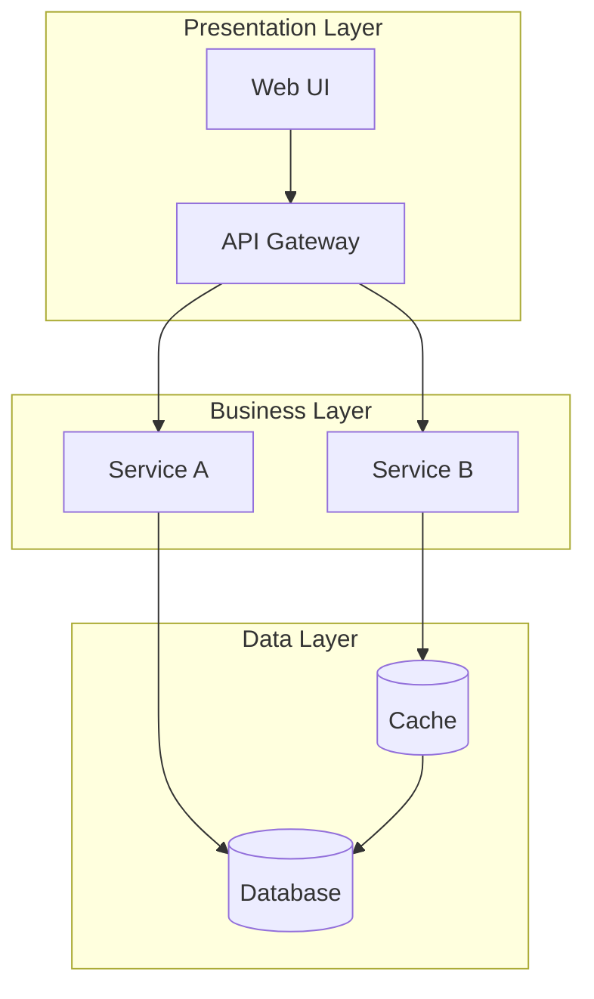
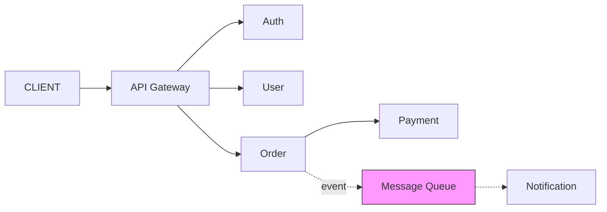
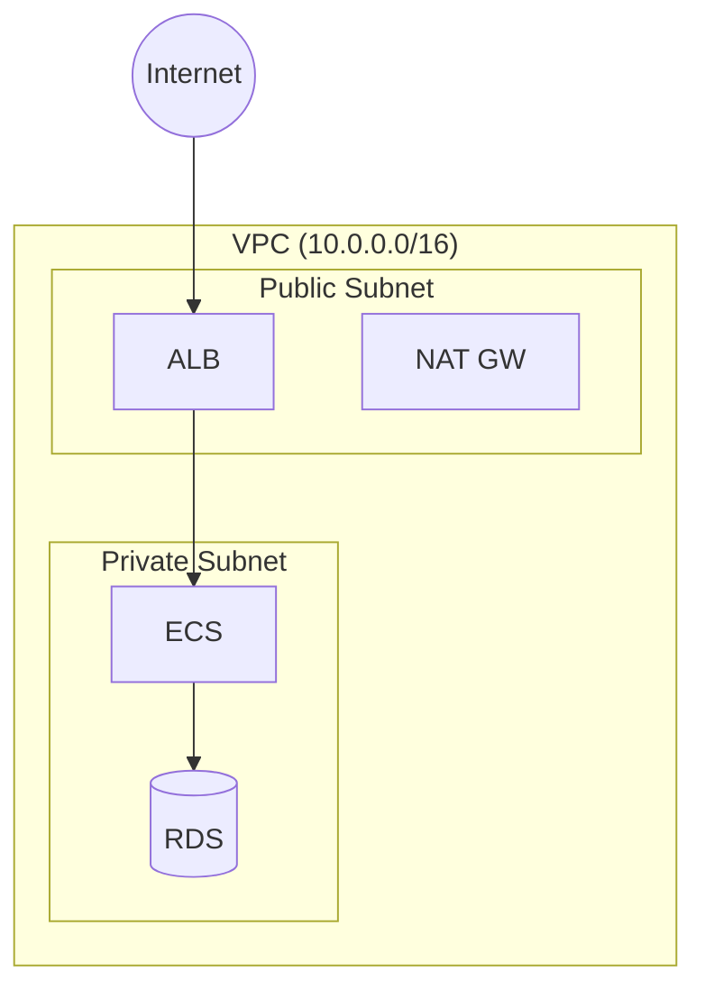
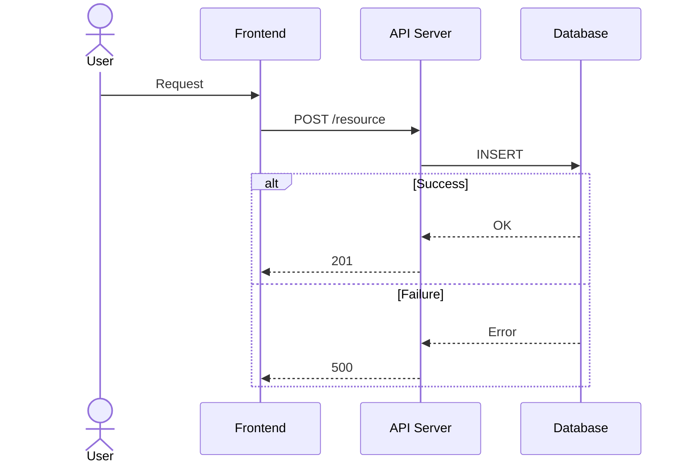
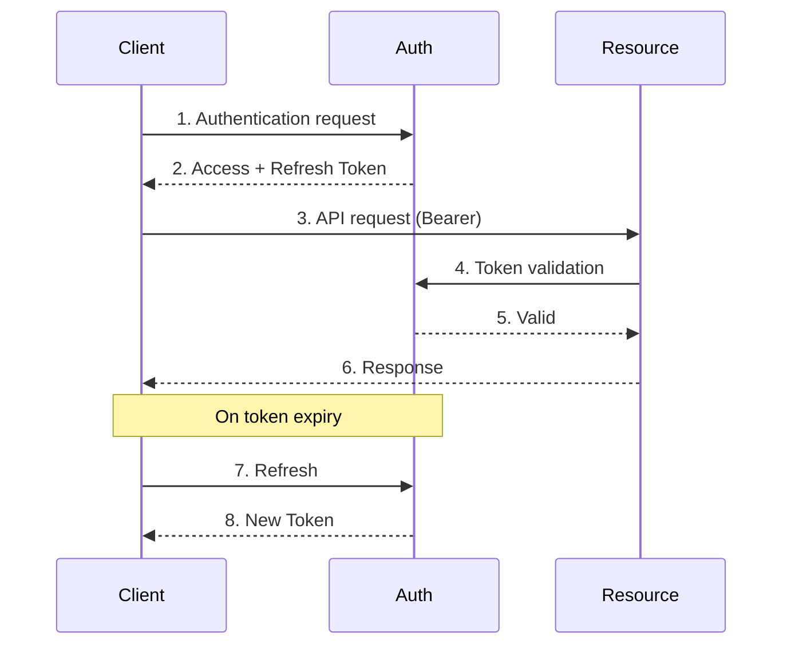
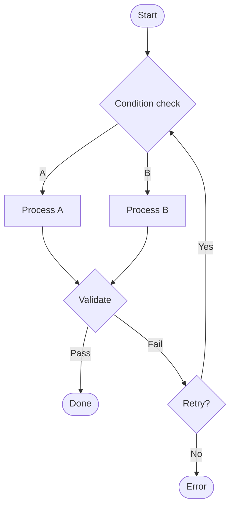
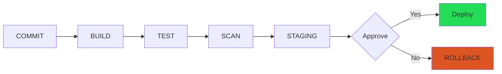
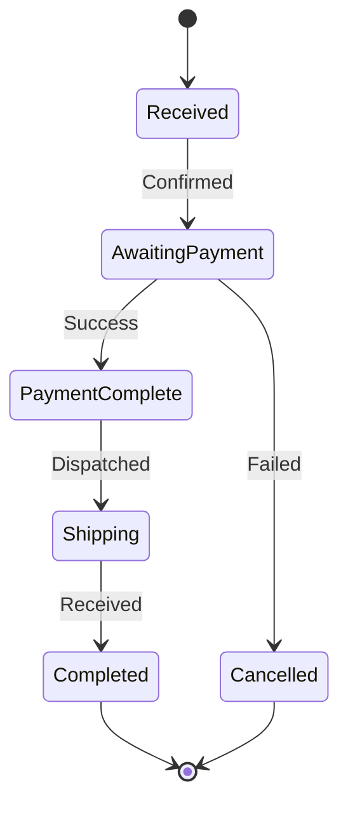

# Diagram Patterns — Mermaid Diagram Pattern Library

A collection of verified patterns that improve the diagram quality of the diagram-maker agent.

## Architecture Diagram Patterns

### Pattern 1: Layered Architecture



**When to use**: Monolithic or layer-separated systems
**Core rules**: Use subgraph to delineate layers; use TD direction; keep to 3–4 nodes per layer

### Pattern 2: Microservices Communication



**Core rules**: Synchronous = solid line, asynchronous = dashed line, highlight message queue with color

### Pattern 3: Cloud Infrastructure Topology



**Core rules**: Nested subgraph = network boundary; circle node = external

## Sequence Diagram Patterns

### Pattern 4: API Call (Happy Path + Error)



**Core rules**: alt/else branching; request = solid line, response = dashed line

### Pattern 5: OAuth 2.0 Authentication Flow



## Flowchart Patterns

### Pattern 6: Decision Flow



**Core rules**: Diamond = decision; rounded rectangle = start/end; loop = circular arrow

### Pattern 7: CI/CD Pipeline



## ER Diagram Patterns

### Pattern 8: Data Model

```mermaid
erDiagram
    USER ||--o{ ORDER : places
    ORDER ||--|{ ORDER_ITEM : contains
    ORDER_ITEM }o--|| PRODUCT : "refers to"
    USER { int id PK; string email UK; string name }
    ORDER { int id PK; int user_id FK; string status }
```

## State Diagram Patterns

### Pattern 9: State Transition



## Diagram Quality Checklist

| Item | Standard |
|------|----------|
| Node count | 10 or fewer |
| Labels | 3–5 words |
| Arrow crossings | 0 |
| Legend / caption | Included in all diagrams |
| Colors | Only for meaningful differentiation; maximum 3 colors |
| subgraph depth | Maximum 2 levels |

## Anti-Patterns

| Anti-Pattern | Solution |
|-------------|----------|
| Spaghetti (arrow crossings) | Rearrange nodes, split into subgraphs |
| Excessive detail | Unify abstraction level |
| Unlabeled arrows | Add verb-form labels to all relationships |
| Inconsistent node shapes | Standardize by type |
