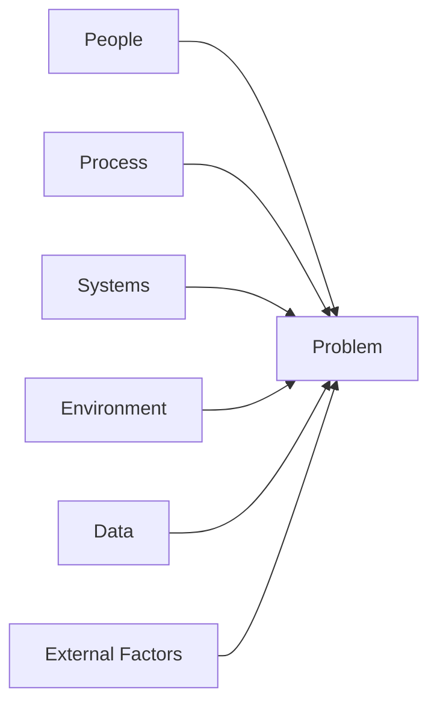

# Facilitation Techniques — Facilitation Techniques Library

A collection of techniques that strengthen the meeting design capabilities of the agenda-architect and followup-planner agents.

## Facilitation Design by Meeting Type

| Meeting Type | Purpose | Duration | Recommended Techniques |
|-------------|---------|----------|----------------------|
| Brainstorming | Divergent idea generation | 30–60 min | 6-3-5, Round Robin |
| Decision-making | Consensus / selection | 30–60 min | DACI, Dot Voting |
| Problem-solving | Root cause → solution | 60–90 min | 5 Whys, Fishbone |
| Strategy development | Direction setting | 90–120 min | SWOT, Scenario planning |
| Retrospective | Improvement identification | 45–60 min | Start-Stop-Continue |
| Kickoff | Alignment / information sharing | 60–90 min | Project Canvas |

## Idea Generation Techniques

### 6-3-5 Brainwriting

```
Rules:
- 6 participants
- Each person writes 3 ideas (5 minutes)
- Pass sheet to the next person → develop or add to existing ideas (5 minutes)
- Repeat for 5 rounds
- Total output: up to 108 ideas (30 minutes)

Advantage: Prevents dominance by vocal participants; ensures introverts contribute
```

### Lightning Demos

```
1. Each participant prepares 1 benchmark case in advance
2. 3-minute demo / presentation per person
3. Record inspiration on "Big Ideas" post-its
4. Cluster ideas → identify core themes
```

## Problem-Solving Techniques

### 5 Whys Structure

```
Problem: [describe the symptom]
Why 1: Why did [symptom] occur? → [Cause 1]
Why 2: Why did [Cause 1] occur? → [Cause 2]
Why 3: Why did [Cause 2] occur? → [Cause 3]
Why 4: Why did [Cause 3] occur? → [Cause 4]
Why 5: Why did [Cause 4] occur? → [Root Cause]

→ Develop corrective actions targeting the root cause
```

### Fishbone Diagram (Ishikawa)



6M categories: Man, Method, Machine, Material, Measurement, Mother Nature

## Time Management Techniques

### Timebox Guide

| Activity | Recommended Time | Maximum |
|----------|-----------------|---------|
| Icebreaker | 5 min | 10 min |
| Context sharing | 10 min | 15 min |
| Individual silent work | 5–10 min | 15 min |
| Small group discussion | 10–15 min | 20 min |
| Full group sharing | 2–3 min per person | 5 min per person |
| Decision-making | 10–15 min | 30 min |
| Follow-up wrap-up | 5 min | 10 min |

### Parking Lot

```
When discussion drifts off topic during the meeting:
1. "Good point. Let me add that to the Parking Lot."
2. Record on a separate board or section
3. Review the Parking Lot before closing the meeting
4. Assign follow-up action for each item
```

## Retrospective Techniques

### Start-Stop-Continue

| Category | Question |
|----------|---------|
| **Start** | What should we start doing? |
| **Stop** | What should we stop doing? |
| **Continue** | What should we keep doing? |

### 4Ls Retrospective

| L | Question |
|---|---------|
| **Liked** | What did we like? |
| **Learned** | What did we learn? |
| **Lacked** | What was missing? |
| **Longed for** | What did we wish for? |

## Follow-Up Structuring

### SMART Action Items

| Element | Description | Example |
|---------|-------------|---------|
| Specific | What will be done | "Draft customer survey questions" |
| Measurable | Completion standard | "20 questions, completable in under 5 min" |
| Assignee | Who | Kim (Team Lead) |
| Deadline | By when | By January 31 |
| Tracking method | Where to check | Jira PROJ-123 |

## Quality Checklist

| Item | Standard |
|------|---------|
| Time allocation per agenda item | Timebox specified |
| Participant roles | Facilitator / secretary / timekeeper assigned |
| Ground Rules | Shared at the start of the meeting |
| Balanced participation | Ensured through techniques (round-robin, etc.) |
| Action items | Meet SMART criteria |
| Parking Lot | Follow-up assigned for all unresolved items |
